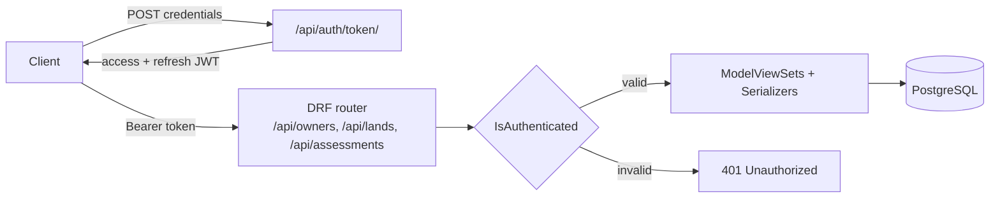
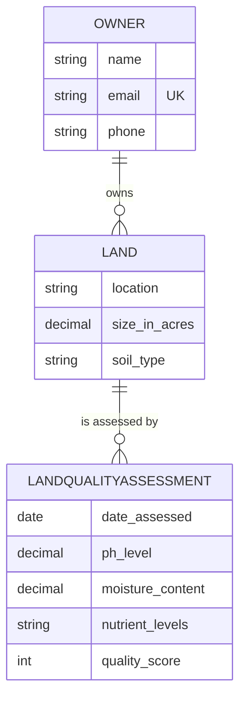

<div align="center">


</div>

A backend API for managing **land owners, land parcels and soil quality assessments**. Every endpoint requires a JSON Web Token, so records are only readable and writable by authenticated clients.

## ✨ Features

- 🔐 **JWT authentication** with access and refresh tokens (`djangorestframework-simplejwt`)
- 🧑‍🌾 **Owners**, 🌍 **Lands** and 🧪 **Quality assessments** exposed as full CRUD resources
- 📐 Assessments record **pH level, moisture content, nutrient levels and a quality score** per parcel
- 🔗 Relational model: an owner has many lands, and a land has many assessments
- 🐘 PostgreSQL storage with environment-based configuration (no secrets in the code)
- 🐳 Docker Compose setup for the API and its database

## 🏗️ Architecture



### Data model



## 🔌 API reference

| Method | Endpoint | Purpose |
|---|---|---|
| `POST` | `/api/auth/token/` | Obtain access and refresh tokens |
| `POST` | `/api/auth/token/refresh/` | Refresh an access token |
| `GET, POST` | `/api/owners/` | List or create owners |
| `GET, PUT, PATCH, DELETE` | `/api/owners/{id}/` | Retrieve, update or delete an owner |
| `GET, POST` | `/api/lands/` | List or create land parcels |
| `GET, PUT, PATCH, DELETE` | `/api/lands/{id}/` | Retrieve, update or delete a parcel |
| `GET, POST` | `/api/assessments/` | List or create quality assessments |
| `GET, PUT, PATCH, DELETE` | `/api/assessments/{id}/` | Retrieve, update or delete an assessment |

All resource endpoints need the header `Authorization: Bearer <access token>`.

## 🚀 Getting started

### With Docker

```bash
git clone https://github.com/Brian-Dol/land-quality-api.git
cd land-quality-api
cp .env.example .env        # then edit the secrets
docker compose up --build
```

### Locally

```bash
python -m venv venv
source venv/bin/activate    # Windows: venv\Scripts\activate
pip install -r requirements.txt
cp .env.example .env        # point DB_HOST at your PostgreSQL instance
python manage.py migrate
python manage.py createsuperuser
python manage.py runserver
```

The API is served at `http://localhost:8000/api/`.

### Try it

```bash
# 1. Get a token
curl -X POST http://localhost:8000/api/auth/token/ \
  -H "Content-Type: application/json" \
  -d '{"username": "admin", "password": "your-password"}'

# 2. Create a land parcel with the returned access token
curl -X POST http://localhost:8000/api/lands/ \
  -H "Authorization: Bearer <access>" -H "Content-Type: application/json" \
  -d '{"owner": 1, "location": "Nakuru", "size_in_acres": "12.50", "soil_type": "loam"}'
```

## 🧰 Tech stack

| Layer | Technology |
|---|---|
| Language | Python |
| Framework | Django, Django REST Framework |
| Auth | SimpleJWT |
| Database | PostgreSQL |
| Config | django-environ |
| Packaging | Docker, Docker Compose |

## 🗺️ Roadmap

This is a focused learning and portfolio project. Known gaps and next steps:

- [ ] Automated tests for the serializers and permissions
- [ ] Per-owner permissions, so users only see their own parcels
- [ ] Pagination, filtering and OpenAPI documentation
- [ ] Coordinate-based analysis (PostGIS and external geospatial data sources)
- [ ] CI pipeline with GitHub Actions

## 👤 Author

**Brian Dol**, Senior Full Stack Engineer · [Portfolio](https://portfolio.dol-brian23.workers.dev/) · [LinkedIn](https://linkedin.com/in/brian-dol-31a06115a/)
